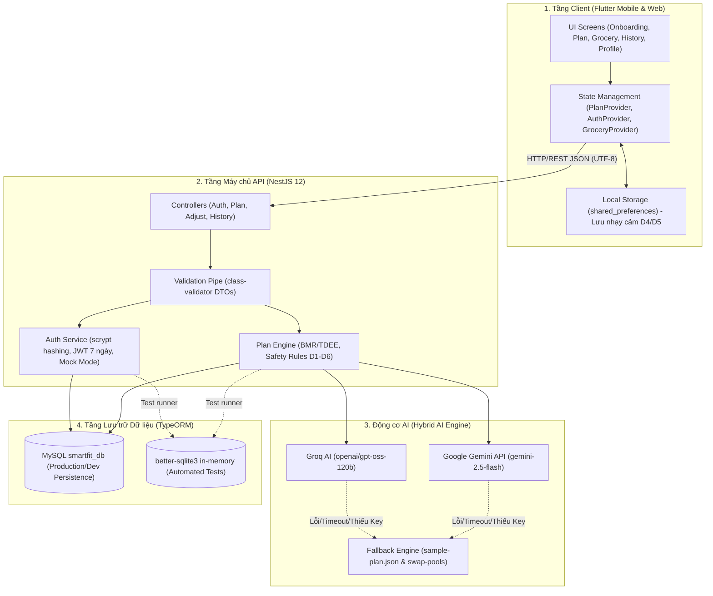
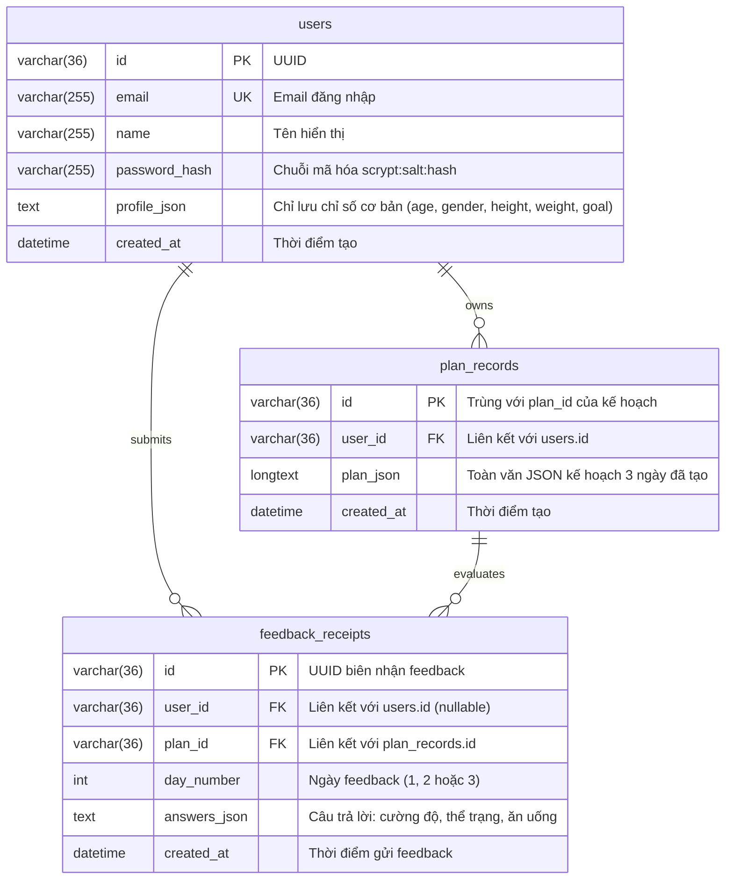

# SmartFit AI — Architecture Documentation (Tài liệu Kiến trúc Hệ thống)

> **Dự án:** SmartFit AI — Hệ thống gợi ý & điều chỉnh thực đơn món Việt và bài tập thích ứng 3 ngày  
> **Đồ án:** AI Product Development End-to-End — Đại học Công nghệ Thông tin và Truyền thông Việt - Hàn (VKU)  
> **Phiên bản kiến trúc:** 2.6.0 (Cập nhật tháng 11/2026)  
> **Tài liệu liên quan:** [FLOWCHARTS.md](FLOWCHARTS.md) (Sơ đồ luồng & trình tự Mermaid), [API_DOCUMENTATION.md](API_DOCUMENTATION.md) (Đặc tả chi tiết API & Swagger)

---

## 1. Tổng quan Kiến trúc Hệ thống (System Overview)

SmartFit AI được xây dựng theo mô hình **Monorepo** phân tầng rõ rệt, kết hợp giữa ứng dụng di động đa nền tảng (**Flutter**), máy chủ dịch vụ (**NestJS 12**) và động cơ trí tuệ nhân tạo (**Groq / Gemini AI Engine**) kèm cơ chế fallback dữ liệu mẫu chuẩn y khoa.

### Sơ đồ Kiến trúc Tổng thể (High-Level Diagram)



---

## 2. Phân rã các Thành phần Monorepo

### 2.1. `frontend_app/` (Ứng dụng Client)
* **Framework:** Flutter 3.x / Dart (biên dịch chéo Android, iOS, Web, macOS).
* **Quản lý trạng thái (State Management):** Mô hình `Provider` & `ChangeNotifier`:
  * `PlanProvider`: Quản lý vòng đời kế hoạch 3 ngày, ngày bắt đầu theo lịch thực tế, logic đổi món/bài, gửi feedback cuối ngày và draft hồ sơ.
  * `AuthProvider`: Quản lý phiên đăng nhập (JWT token), thông tin tài khoản, và lịch sử kế hoạch đã lưu trên server.
  * `GroceryProvider`: Quản lý danh sách nguyên liệu đi chợ theo 3 nhóm (*Đạm*, *Rau củ*, *Gia vị & Tinh bột*) kèm trạng thái tick chọn `bought` / `already_have`.
* **Lưu trữ Offline:** `shared_preferences` lưu cục bộ:
  * Token truy cập: `smartfit.access_token`
  * Dữ liệu nhạy cảm (D4 & D5): Dị ứng, chấn thương, bệnh nền chỉ lưu trên máy người dùng, **tuyệt đối không gửi lưu vĩnh viễn trên database server**.

### 2.2. `backend_api/` (Máy chủ Dịch vụ)
* **Framework:** NestJS 12 chạy trên nền tảng Node.js ESM (`"type": "module"`).
* **Kiến trúc mô-đun:**
  * `src/plan/`: Tính toán chỉ số chuyển hóa (BMR theo Mifflin-St Jeor, TDEE), điều chỉnh calo theo mục tiêu (D1), tạo kế hoạch dinh dưỡng & tập luyện 3 ngày cuốn chiếu.
  * `src/plan/adjust/`: Xử lý đổi món (`/meals/swap`), đổi bài tập (`/exercises/swap`) và nhận phản hồi cuối ngày (`/feedback`).
  * `src/auth/`: Đăng ký, đăng nhập email/mật khẩu, đổi mật khẩu, cơ chế băm `scrypt`, cấp phát JWT 7 ngày, chế độ Mock Auth (`mock:<email>`).
  * `src/history/`: Quản lý và truy xuất lịch sử các kế hoạch của người dùng đã đăng nhập.
* **Định dạng dữ liệu:** Chuẩn hóa theo `BRD.md §6` v2.6.0.

### 2.3. `ai_workspace/` (Môi trường Thử nghiệm Prompt)
* Dự án TypeScript độc lập để đánh giá, đo lường độ trễ (latency), tỷ lệ tuân thủ schema JSON và kiểm thử các chiến lược prompt trước khi đưa vào code sản phẩm tại `backend_api`.

---

## 3. Sơ đồ Thực thể Cơ sở Dữ liệu (Entity Relationship Diagram - ERD)

Toàn bộ dữ liệu bền vững được quản lý qua TypeORM trên cơ sở dữ liệu **MySQL `smartfit_db`**:



> [!IMPORTANT]
> **Rào cản an toàn dữ liệu nhạy cảm (D4 & D5):** Bảng `users` và `plan_records` **KHÔNG BAO GIỜ** chứa các cột về dị ứng, chấn thương hay bệnh lý nền. Dữ liệu này chỉ truyền tạm trong request body để AI tính toán rồi giải phóng khỏi RAM server.

---

## 4. Kiến trúc Động cơ AI & Chiến lược Dự phòng (AI Fallback Engine)

Hệ thống triển khai cơ chế **Fail-Safe** đảm bảo độ khả dụng đạt 99.9% ngay cả khi nhà cung cấp AI gặp sự cố:

```
[Request tạo kế hoạch] 
          │
          ▼
[Tính toán BMR, TDEE, Calo mục tiêu chuẩn y khoa]
          │
          ▼
[Kiểm tra API Key AI (Groq / Gemini)]
    ├── Có Key ──> [Gọi LLM với Structured JSON Output & Timeout 20s]
    │                     │
    │                     ├── Thành công & Schema hợp lệ ──> [Trả kế hoạch AI (source: "groq" / "gemini")]
    │                     └── Thất bại / Timeout / Lỗi Contract
    │                                  │
    └── Không có Key ──────────────────┼──> [Fallback Engine (source: "sample")]
                                       │    1. Lọc món theo dị ứng (restriction-matcher)
                                       │    2. Lọc bài theo chấn thương & độ tuổi
                                       │    3. Cân bằng calo chuẩn tỷ lệ 25/45/30
                                       │    4. Gán UUID và tạo danh sách đi chợ tự động
```

---

## 5. Rào cản An toàn Lâm sàng & Y tế (Decisions D1–D6)

Hệ thống tích hợp sẵn các quy tắc kiểm tra an toàn sức khỏe tự động ở cả 2 đầu Frontend và Backend:

1. **Quy tắc calo (D1):** Giảm mỡ (`cut`) giảm cố định −300 kcal/ngày; Tăng cơ (`bulk`) tăng +250 kcal/ngày; Duy trì (`maintain`) giữ nguyên TDEE. Calo không bao giờ bị ép xuống dưới mức chuyển hóa cơ bản (BMR).
2. **Quy tắc an toàn lâm sàng (D6):**
   * **BMI < 18.5:** Chặn tuyệt đối mục tiêu "Giảm mỡ" ở cả Form nhập liệu và Backend API (trả HTTP 400).
   * **Độ tuổi:** Giới hạn nghiêm ngặt từ 18 đến 100 tuổi.
   * **Mang thai / cho con bú:** Cấm thâm hụt calo, giới hạn bài tập ở mức 1 nhẹ nhàng.
3. **Quy tắc dấu hiệu nguy hiểm (D2):** Khi người dùng báo có triệu chứng đau ngực, khó thở, chóng mặt trong feedback cuối ngày:
   * Hệ thống **không gọi AI điều chỉnh tiếp**, tự động khuyến cáo ngưng tập, đi khám bác sĩ và chuyển ngày kế tiếp sang nghỉ ngơi hoặc đi bộ nhẹ.
