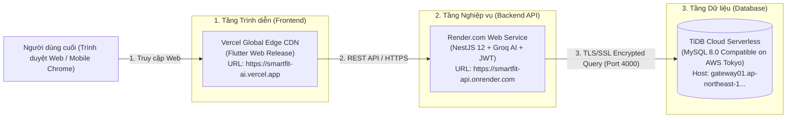

# SmartFit AI — Hướng dẫn Triển khai Hệ thống (Deployment Guide)

> **Dự án:** SmartFit AI — Adaptive Meal & Workout Planner (VKU Capstone Project)  
> **Kiến trúc triển khai:** 3-Tier Cloud Architecture (Vercel + Render + TiDB Cloud MySQL)  
> **Trạng thái:** Sẵn sàng cho Production  

---

## 1. Sơ đồ Kiến trúc Triển khai (3-Tier Cloud Topology)



---

## 2. Bước 1: Chuẩn bị Cơ sở Dữ liệu (TiDB Cloud MySQL)

1. Đăng nhập vào [TiDB Cloud Console](https://tidbcloud.com).
2. Tạo cụm **Starter (Serverless - $0/tháng)**:
   - Region: `Tokyo (ap-northeast-1)` hoặc `Singapore (ap-southeast-1)`.
   - Name: `smartfit-db`.
3. Bấm **Connect** $\rightarrow$ **Generate Password** $\rightarrow$ Lưu lại mật khẩu an toàn.
4. Thông số kết nối thu được:
   - `DB_TYPE`: `mysql`
   - `DB_HOST`: `gateway01.ap-northeast-1.prod.aws.tidbcloud.com`
   - `DB_PORT`: `4000`
   - `DB_USERNAME`: `<cluster_prefix>.root`
   - `DB_PASSWORD`: `<your_password>`
   - `DB_DATABASE`: `test` (hoặc tạo database `smartfit_db`)
   - `DB_SSL`: `true`

---

## 3. Bước 2: Triển khai Backend API lên Render.com

1. Đăng nhập [Render.com](https://render.com) bằng tài khoản GitHub.
2. Bấm **New +** $\rightarrow$ Chọn **Web Service**.
3. Chọn GitHub repository: `AI-Product-Development-End-to-End`.
4. Cấu hình cơ bản:
   - **Name:** `smartfit-api`
   - **Region:** `Singapore` (hoặc `Frankfurt / Ohio`)
   - **Root Directory:** `backend_api`
   - **Runtime:** `Node`
   - **Build Command:** `npm install && npm run build`
   - **Start Command:** `npm run start:prod`
   - **Instance Type:** `Free` ($0/tháng)
5. Cấu hình **Environment Variables** (Biến môi trường):
   | Tên biến | Giá trị mẫu / Hướng dẫn |
   |---|---|
   | `NODE_ENV` | `production` |
   | `DB_TYPE` | `mysql` |
   | `DB_HOST` | `gateway01.ap-northeast-1.prod.aws.tidbcloud.com` |
   | `DB_PORT` | `4000` |
   | `DB_USERNAME` | `<ti_db_username>` |
   | `DB_PASSWORD` | `<ti_db_password>` |
   | `DB_DATABASE` | `test` |
   | `DB_SSL` | `true` |
   | `GROQ_API_KEY` | `<your_groq_api_key>` (Nếu không có key, hệ thống tự động chạy fallback thực đơn mẫu) |
   | `JWT_SECRET` | `smartfit_secure_jwt_secret_vku_2026` |
   | `CORS_ORIGINS` | Domain Vercel của bạn (ví dụ: `https://smartfit-ai.vercel.app`) |
6. Bấm **Deploy Web Service** và đợi khoảng 2 phút. Sau khi hoàn tất, Render sẽ cấp URL:
   `https://smartfit-api.onrender.com`

---

## 4. Bước 3: Triển khai Frontend Flutter Web lên Vercel

### Cách A: Triển khai qua lệnh Vercel CLI (Nhanh nhất)
1. Trên máy tính cá nhân, mở thư mục `frontend_app`:
   ```bash
   cd frontend_app
   # Build bản release với URL backend Render vừa tạo ở Bước 2:
   flutter build web --release --dart-define=API_BASE_URL=https://smartfit-api.onrender.com
   ```
2. Deploy thư mục `build/web` lên Vercel:
   ```bash
   npx vercel deploy build/web --prod
   ```

### Cách B: Cấu hình `vercel.json` định tuyến SPA
Trong thư mục `frontend_app/web/` hoặc `build/web/`, file `vercel.json` đảm bảo reload trang không bị lỗi 404:
```json
{
  "rewrites": [
    { "source": "/(.*)", "destination": "/index.html" }
  ]
}
```

---

## 5. Kiểm tra Hoàn tất & Nghiệm thu Hệ thống

Sau khi deploy xong:
1. Mở đường link Vercel: `https://smartfit-ai.vercel.app` trên Google Chrome (máy tính hoặc điện thoại).
2. Thử nghiệm luồng người dùng:
   - Đăng ký tài khoản mới $\rightarrow$ Lưu thông tin thể chất $\rightarrow$ Tạo thực đơn 3 ngày.
   - Tải lại trang (F5) $\rightarrow$ Dữ liệu vẫn còn nguyên vẹn.
   - Đăng xuất $\rightarrow$ Đăng nhập lại $\rightarrow$ Thông tin thể chất tự động điền sẵn từ TiDB Cloud MySQL.
