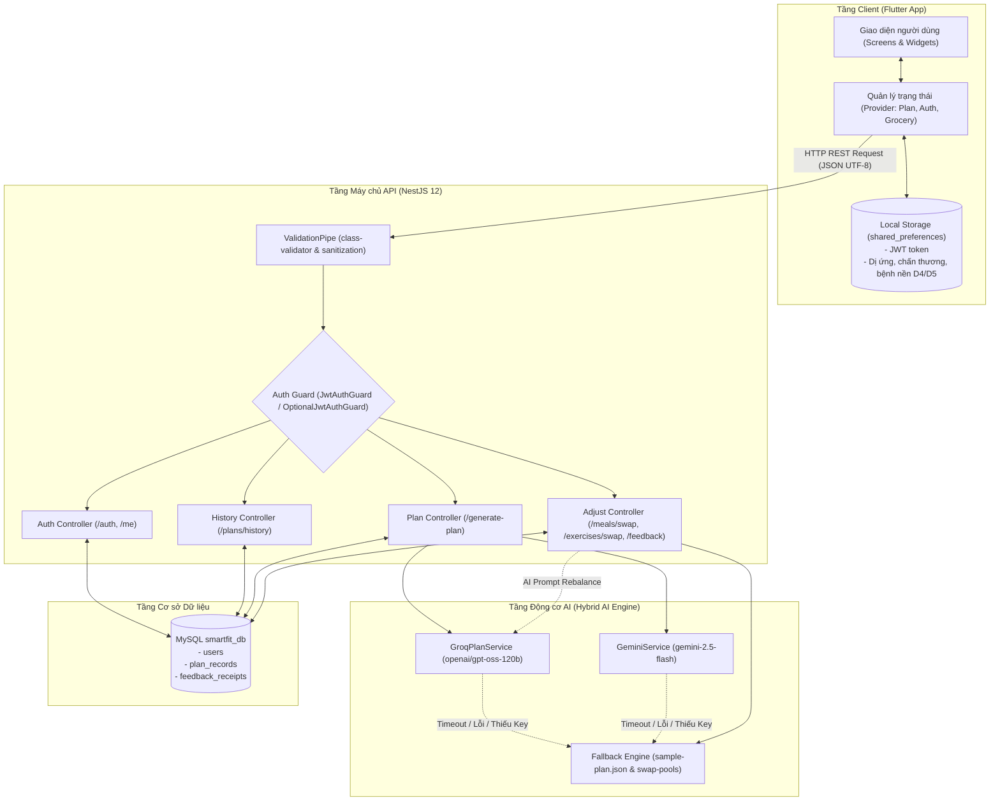
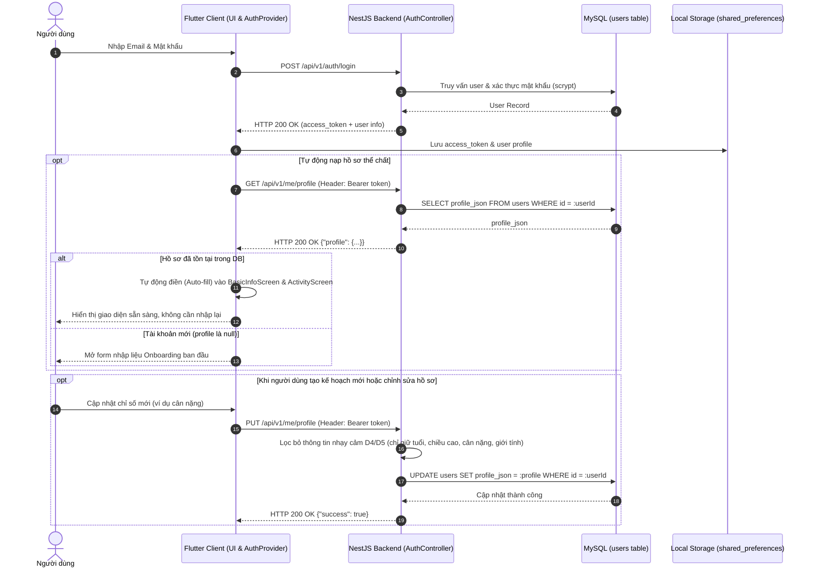
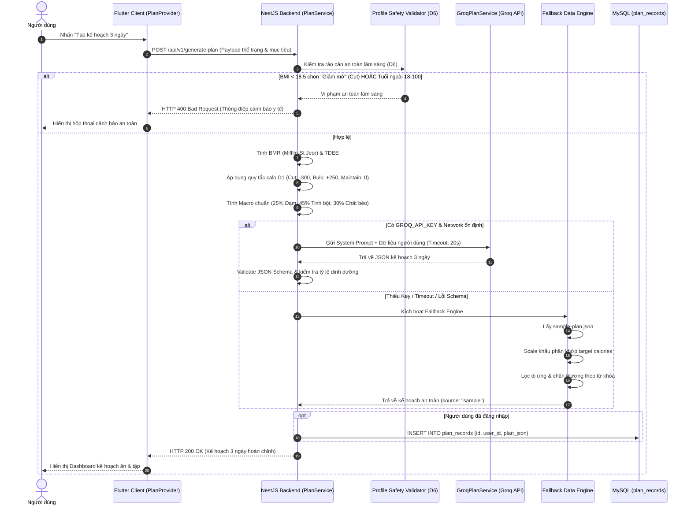
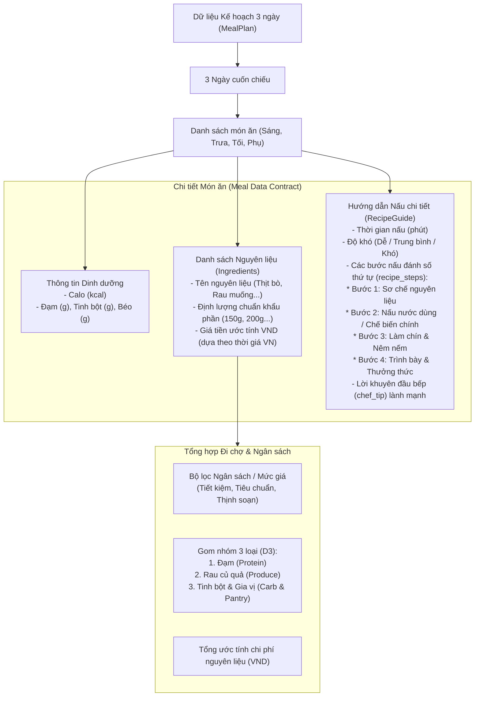
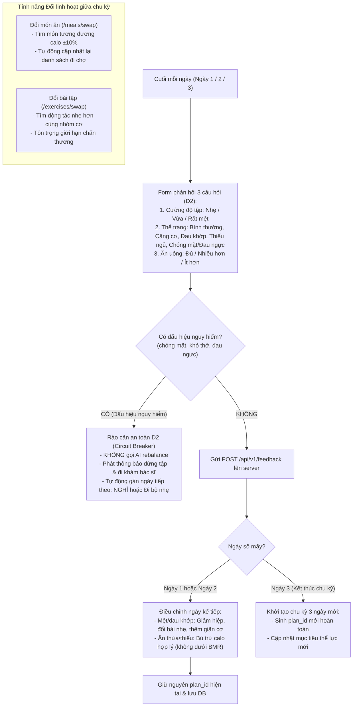
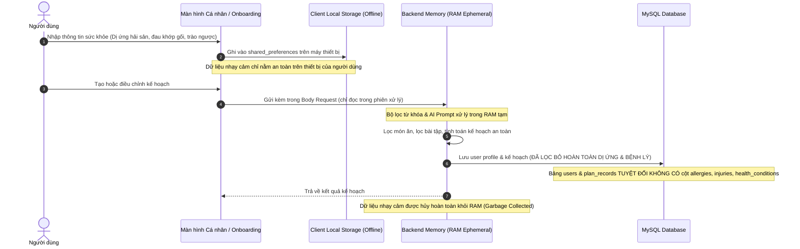

# SmartFit AI — System Flowcharts & Sequence Diagrams (Sơ đồ Luồng Dữ liệu & Trình tự)

> **Dự án:** SmartFit AI — Hệ thống gợi ý & điều chỉnh thực đơn món Việt và bài tập thích ứng 3 ngày  
> **Chuẩn kỹ thuật:** Mermaid Diagram Standards  
> **Tài liệu tham chiếu:** [API_DOCUMENTATION.md](API_DOCUMENTATION.md), [ARCHITECTURE.md](ARCHITECTURE.md), [BRD.md](../BRD.md) v2.6.0  

---

## Mục lục Sơ đồ
1. [Sơ đồ 1: Kiến trúc Tổng thể & Luồng Giao tiếp Hệ thống](#1-kiến-trúc-tổng-thể--luồng-giao-tiếp-hệ-thống)
2. [Sơ đồ 2: Luồng Xác thực & Tự động Đồng bộ Hồ sơ Thể chất](#2-luồng-xác-thực--tự-động-đồng-bộ-hồ-sơ-thể-chất)
3. [Sơ đồ 3: Luồng Khởi tạo Kế hoạch An toàn & Động cơ AI Hybrid](#3-luồng-khởi-tạo-kế-hoạch-an-toàn--động-cơ-ai-hybrid)
4. [Sơ đồ 4: Luồng Trích xuất Hướng dẫn Nấu ăn & Ước tính Ngân sách](#4-luồng-trích-xuất-hướng-dẫn-nấu-ăn--ước-tính-ngân-sách)
5. [Sơ đồ 5: Luồng Đổi món, Đổi bài & Vòng lặp Phản hồi Cuối ngày Thích ứng](#5-luồng-đổi-món-đổi-bài--vòng-lặp-phản-hồi-cuối-ngày-thích-ứng)
6. [Sơ đồ 6: Luồng Bảo mật Quyền riêng tư & Dữ liệu Nhạy cảm (D4 & D5)](#6-luồng-bảo-mật-quyền-riêng-tư--dữ-liệu-nhạy-cảm-d4--d5)

---

## 1. Kiến trúc Tổng thể & Luồng Giao tiếp Hệ thống

Sơ đồ mô tả sự tương tác giữa 4 tầng chính: Client (Flutter), API Gateway / Backend (NestJS), Động cơ Trí tuệ Nhân tạo (Groq / Gemini / Fallback), và Cơ sở dữ liệu (MySQL / LocalStorage).

---

## 2. Luồng Xác thực & Tự động Đồng bộ Hồ sơ Thể chất

Quy trình giải quyết bài toán: Người dùng chỉ cần nhập hồ sơ thể chất (tuổi, chiều cao, cân nặng, giới tính, mục tiêu, mức vận động) trong lần đầu tiên; các lần đăng nhập tiếp theo hệ thống tự động nạp hồ sơ từ DB vào ứng dụng mà không bắt nhập lại.

---

## 3. Luồng Khởi tạo Kế hoạch An toàn & Động cơ AI Hybrid

Luồng xử lý tính toán năng lượng y khoa (Mifflin-St Jeor), kiểm tra rào cản lâm sàng (D6) và điều phối giữa mô hình ngôn ngữ lớn (Groq LLM) và bộ quy tắc dự phòng mẫu (Fallback Engine).

---

## 4. Luồng Trích xuất Hướng dẫn Nấu ăn & Ước tính Ngân sách

Mô tả cách ứng dụng tổ chức dữ liệu chi tiết cho từng món ăn (nguyên liệu, lượng gam, giá tiền ước tính VND, các bước sơ chế - chế biến - trình bày) và bộ lọc theo mức giá.

---

## 5. Luồng Đổi món, Đổi bài & Vòng lặp Phản hồi Cuối ngày Thích ứng

Sơ đồ thích ứng rolling 3-day cycle: Cho phép đổi món ăn (lệch calo ≤ ±10%), đổi bài tập (nhẹ hơn cùng nhóm cơ), và vòng lặp phản hồi cuối ngày với rào cản ngắt khẩn cấp D2 (Danger Signs Circuit Breaker).

---

## 6. Luồng Bảo mật Quyền riêng tư & Dữ liệu Nhạy cảm (D4 & D5)

Thiết kế kiến trúc bảo vệ dữ liệu sức khỏe người dùng: Tuyệt đối không lưu vết bệnh lý cá nhân tại cơ sở dữ liệu trung tâm.

